# Spectre Directive

Directive is a resumable mission reducer. It holds a mission, plan and working
context, emits one correlated request at a time, and applies the host's answer to
reach the next request or outcome. It is useful without an AgentServer: the pure
API passes state explicitly, and an optional OTP runtime can own standalone missions.

In Spectre 0.4 the AgentServer is already the owner. Install Directive in the
Stack and use its **pure reducer helper**; the Server chooses the model, asks the
user questions and proposes consequential effects through GAM. Directive does not
silently start another actor, call a model or execute a requested function.



[Diagram source](docs/assets/readme-architecture.mmd).

Directive owns mission transitions and request correlation. The Server decides
how to answer each request and submits consequential work to GAM.

## Installation

Add the packages to your application:

```elixir
defp deps do
  [
    {:spectre, "~> 0.4.0"},
    {:spectre_directive, "~> 0.1.0"}
  ]
end
```

For local development, use `SPECTRE_PATH=../spectre` when testing this repository.

## Start a mission in AgentServer

```elixir
defmodule MyApp.AI do
  use Spectre.Stack
  install Spectre.Directive
end

defmodule MyApp.ResearchServer do
  use Spectre.Server, tools: MyApp.AI

  def handle_flow({:research, :start}, input, ctx) do
    directive(ctx, {:new, %{mission: input.text, reasoner: :model}},
      on_result: :mission)
  end

  def handle_result(:mission,
      {:directive, %{status: :request, state: encoded, data: request}}, ctx) do
    ctx
    |> assign(:mission_state, encoded)
    |> assign(:mission_request, request)
    |> respond("Mission is waiting for #{request.kind}.")
  end

  def handle_result(:mission, {:directive, %{status: :done, data: outcome}}, ctx),
    do: respond(ctx, inspect(outcome))

  def handle_result(tag, result, ctx), do: super(tag, result, ctx)
end

defmodule MyApp.ResearchAgent do
  use Spectre.Agent, stack: MyApp.AI, server: MyApp.ResearchServer
  flow :research do
    on :start, regex: ~r/^research\b/i
  end
end

{:ok, server} = Spectre.Server.start_link(agent: MyApp.ResearchAgent, consumer: self())
{:ok, interaction} = Spectre.Server.input(server, "research a supplier")
```

This starts the mission and exposes its first request; it deliberately waits for
the application to answer it. The [integration guide](docs/SPECTRE_0_4.md) shows
how to continue with `{:respond, encoded_state, request_id, answer}`, handle
reasoning and invocation requests, and preserve correlation across model calls.
The canonical binary is the reducer state, not an executable process or a grant
of authority. Functions and live handles cannot be saved inside it.

## The same reducer outside Spectre.Server

```elixir
{:ok, state} = SpectreDirective.new(mission: "Research a supplier", reasoner: :model)
{:request, request, state} = SpectreDirective.next(state)

next = SpectreDirective.respond(state, request.id,
  {:propose_plan, [%{id: "read", title: "Read the supplier page"}]})
```

`next` is another `{:request, request, state}`, `{:blocked, reason, state}`, or
`{:done, outcome, state}` boundary (invalid replies may return `{:error, reason,
state}`). The pure API never performs the requested work. The optional standalone
runtime and legacy Agent extension are documented separately; their own confirmation
callbacks are not GAM admission or a substitute for an admitted Act.

## Documentation

- [AgentServer integration, helpers and authority](docs/SPECTRE_0_4.md)
- [Migration from the 0.3 integration](docs/MIGRATING_TO_0_4.md)
- [Standalone and retained runtime reference](docs/REDUCER_AND_OTP_RUNTIME.md)
- [Public API](docs/PUBLIC_API.md) and [changelog](CHANGELOG.md)
- [Governed Act Model](https://spectre.guide/en/governed-act-model) and [core tool lifecycle](https://github.com/elchemista/spectre/blob/0.4.0/docs/STACK_TOOLS.md)

## Runtime and examples

The generated `directive` helper also works in [Skill Server callbacks](https://github.com/elchemista/spectre/blob/0.4.0/docs/SKILLS.md).
Skills share the root's GAM Domain; enable governed operations on the root and
allow them in the mount's `governed:` references. The
[core tool guide](https://github.com/elchemista/spectre/blob/0.4.0/docs/STACK_TOOLS.md) covers scheduling and recovery;
[Managed GAM](https://github.com/elchemista/spectre/blob/0.4.0/docs/MANAGED_GAM.md) covers consent and registered execution.

See the [LiveView demo](https://github.com/elchemista/demo_spectre) for an application,
the [Spectre guides](https://spectre.guide) for articles, and the
[release audit](https://github.com/elchemista/spectre/blob/0.4.0/docs/RELEASE_0_4.md) for verified revisions.
