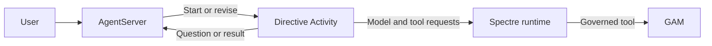

# Spectre Directive

Directive runs resumable missions for Elixir agents. It holds a mission, plan
and working context, and advances them one correlated request at a time.

With Spectre 0.4.1, install Directive in the Stack and start an Activity when
the agent receives a mission. It uses the Agent's model and scoped tools while
the Root continues handling chat. Consequential operations use the same GAM
Domain and approval flow as the Root. The pure reducer and standalone OTP
runtime are also available to other Elixir hosts.



## Installation

Add the packages to your application.

```elixir
defp deps do
  [
    {:spectre, "~> 0.4.1"},
    {:spectre_directive, "~> 0.2.0"}
  ]
end
```

Use `SPECTRE_PATH=../spectre mix test` to try this repository with a local
Spectre 0.4.1 checkout. To try both checkouts from your application, use local
dependencies with paths relative to your application.

```elixir
[
  {:spectre, path: "../spectre", override: true},
  {:spectre_directive, path: "../spectre_directive"}
]
```

## Start a mission in AgentServer

```elixir
defmodule MyApp.AI do
  use Spectre.Stack
  install Spectre.Directive
end

defmodule MyApp.ResearchAgent do
  use Spectre.Agent, stack: MyApp.AI, server: MyApp.ResearchServer

  model MyApp.LLM
  router strategies: [:regex]

  flow :research do
    on :start, regex: ~r/^research\b/i
  end
end

defmodule MyApp.ResearchServer do
  use Spectre.Server

  def handle_flow({:research, :start}, input, ctx) do
    start_activity(ctx, {:directive, :mission}, %{goal: input.text})
  end

  def handle_flow(flow, input, ctx), do: super(flow, input, ctx)

  def handle_activity(_identity, {:completed, %{result: result}}, ctx) do
    respond(ctx, inspect(result))
  end

  def handle_activity(_identity, _event, ctx), do: ctx
end

{:ok, server} = Spectre.Server.start_link(agent: MyApp.ResearchAgent, consumer: self())
{:ok, _interaction} = Spectre.Server.input(server, "research a supplier")
```

`MyApp.LLM` is the application's Spectre model adapter. Each start gets an
independent Activity reference. Use the same reference to revise, cancel or
reply to that mission. See the [AgentServer integration guide](docs/SPECTRE_0_4.md)
for questions, tool permissions, GAM consent and the manual reducer helper.

## The same reducer outside Spectre.Server

```elixir
{:ok, state} = SpectreDirective.new(mission: "Research a supplier", reasoner: :model)
{:request, request, state} = SpectreDirective.next(state)

next = SpectreDirective.respond(state, request.id,
  {:propose_plan, [%{id: "read", title: "Read the supplier page"}]})
```

`next` yields a request, a blocked state or an outcome. Invalid replies may
return `{:error, reason, state}`. The host performs the requested work and
returns the result to the reducer. The standalone runtime and legacy Agent
extension have their own confirmation callbacks.

## Documentation

- [AgentServer integration, helpers and authority](docs/SPECTRE_0_4.md)
- [Migration from the 0.3 integration](docs/MIGRATING_TO_0_4.md)
- [Standalone and retained runtime reference](docs/REDUCER_AND_OTP_RUNTIME.md)
- [Public API](docs/PUBLIC_API.md) and [changelog](CHANGELOG.md)
- [Governed Act Model](https://spectre.guide/en/governed-act-model) and [core tool lifecycle](https://github.com/elchemista/spectre/blob/0.4.0/docs/STACK_TOOLS.md)

## Runtime and examples

Try an [AgentServer mission](examples/agent_server_activity.exs) with the local
Spectre checkout. The example runs with a deterministic model and requires no
credentials.

```bash
SPECTRE_PATH=../spectre mix run examples/agent_server_activity.exs
```

The generated `directive` helper also works in [Skill Server callbacks](https://github.com/elchemista/spectre/blob/0.4.0/docs/SKILLS.md).
Skills share the root's GAM Domain; enable governed operations on the root and
allow them in the mount's `governed:` references. The
[core tool guide](https://github.com/elchemista/spectre/blob/0.4.0/docs/STACK_TOOLS.md) covers scheduling and recovery;
[Managed GAM](https://github.com/elchemista/spectre/blob/0.4.0/docs/MANAGED_GAM.md) covers consent and registered execution.

Run the AgentServer integration test from this repository to see two concurrent
missions, a targeted answer and a governed publication. The test uses a
deterministic model and requires no credentials.

```bash
SPECTRE_PATH=../spectre mix test test/directive_activity_test.exs
```
